# GestionNotes — Mécanisme de mise à jour automatique

**Cours :** Déploiement
**Auteurs :** Lucas Paludetto (2630755) et Mathieu Tenret (2633645)
**Dépôt réseau :** `\\WIN-V9MDIVV3MVO\GestionNotes-Depot`

## 1. Présentation

GestionNotes est une application WPF de gestion de notes. Ce projet lui ajoute un mécanisme de mise à jour programmé en C#, sans ClickOnce, MSIX ni autre outil de déploiement.

Au démarrage, l'application lit un manifeste sur un dossier réseau partagé. Si une version plus récente existe, elle propose la mise à jour, copie l'archive sur le poste, puis confie le remplacement des fichiers au programme auxiliaire `Updater.exe`.

| Version | Contenu |
|---|---|
| 1.0 | Version de départ, avec un bogue dans le calcul de la moyenne |
| 1.1 | Correction du calcul de la moyenne |
| 2.0 | Nouvelle interface et statistiques de groupe (fournie, non utilisée pour la validation) |

### Structure du dépôt

```text
GestionNotes.slnx                     Solution Visual Studio
GestionNotes/                         Application WPF (MVVM)
  App.xaml.cs                         Vérification au démarrage et lancement de Updater
  Models/VersionInfo.cs               Contenu du manifeste
  Services/ServiceMiseAJour.cs        Lecture du manifeste et copie de l'archive
Updater/Program.cs                    Remplacement des fichiers et redémarrage
depot/version.json                    Modèle du manifeste
docs/captures/                        Captures d'écran du rapport
```

## 2. Configuration du dépôt réseau

### 2.1 Création du partage

Sur la machine virtuelle, dans PowerShell en administrateur :

```powershell
New-Item -ItemType Directory -Path C:\GestionNotes-Depot
New-SmbShare -Name GestionNotes-Depot -Path C:\GestionNotes-Depot -ReadAccess "Tout le monde" -ChangeAccess "Administrateur"
icacls C:\GestionNotes-Depot /grant "*S-1-1-0:(OI)(CI)RX"
New-NetFirewallRule -DisplayName "SMB GestionNotes" -Direction Inbound -Protocol TCP -LocalPort 445 -Action Allow
```

### 2.2 Permissions

Windows applique deux niveaux de permissions à un accès réseau. Les permissions de **partage** ne s'appliquent qu'aux accès passant par le réseau. Les permissions **NTFS** s'appliquent aux accès réseau et locaux. Lors d'un accès réseau, c'est la plus restrictive des deux qui s'applique.

Un client n'a besoin que de lire le dépôt. Le compte qui publie les versions a aussi besoin d'écrire.

| Compte | Rôle | Permission de partage | Permission NTFS |
|---|---|---|---|
| Tout le monde | Lecture du dépôt | Lecture | Lecture et exécution |
| Administrateur | Publication des versions | Modifier | Contrôle total |

La VM n'étant pas dans le domaine de l'école, le poste s'y connecte avec le compte local `Administrateur` de la VM :

```powershell
net use \\10.77.64.50\GestionNotes-Depot /user:WIN-V9MDIVV3MVO\Administrateur *
```

Cette commande n'attribue aucune lettre de lecteur : l'application continue d'utiliser le chemin UNC.

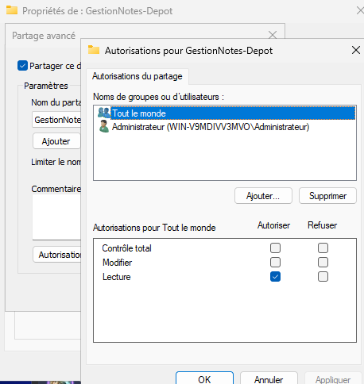

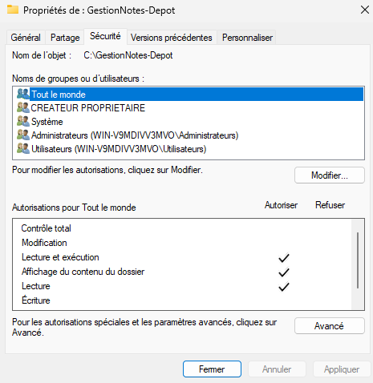

### 2.3 Validation de l'accès

L'accès a été validé depuis le poste de l'école `A5003-08` en ouvrant le chemin suivant dans l'Explorateur de fichiers, avec l'adresse IP de la VM (`10.77.64.50`) :

```text
\\10.77.64.50\GestionNotes-Depot
```

L'application utilise uniquement le chemin UNC `\\WIN-V9MDIVV3MVO\GestionNotes-Depot`, jamais un lecteur réseau mappé. Il est défini dans `GestionNotes/Services/ServiceMiseAJour.cs`.

Test de la connexion SMB depuis le poste :

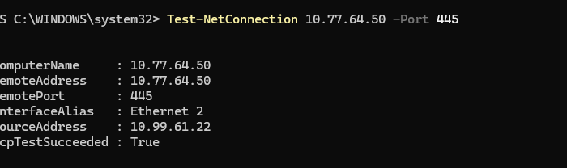

Connexion au partage avec le compte de la VM :

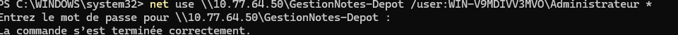

Partage ouvert depuis le poste, avec des fichiers de test copiés dans le dépôt :

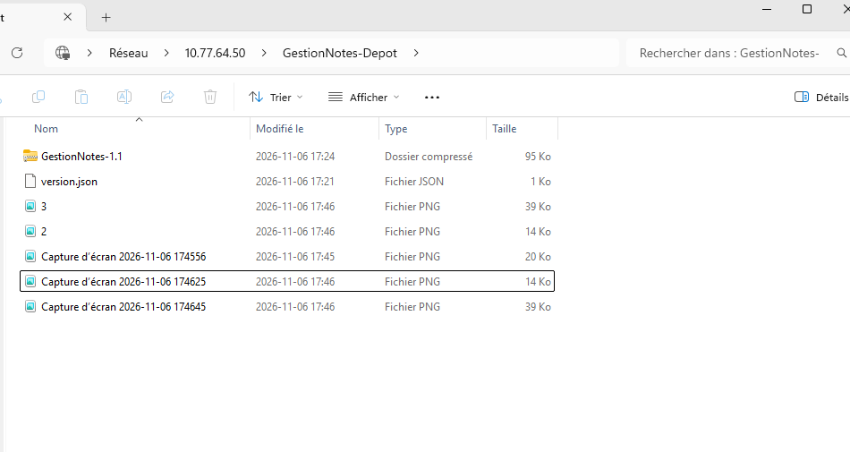

En cas d'échec, vérifier dans l'ordre la connectivité réseau, le nom de la VM, le pare-feu Windows, le service de partage de fichiers et les permissions.

## 3. Installation sur le poste client

Le SDK .NET 10 est requis. Les versions sont marquées par les tags Git `v1.0` et `v1.1`. Depuis la racine du dépôt :

```powershell
git checkout v1.0
dotnet publish GestionNotes\GestionNotes.csproj -c Release -o C:\GestionNotes
dotnet publish Updater\Updater.csproj -c Release -o C:\GestionNotes
```

`GestionNotes.exe` et `Updater.exe` doivent se trouver dans le même dossier. Les données de l'application sont dans `%LocalAppData%\GestionNotes`, donc elles sont conservées pendant une mise à jour.

**Environnement de test :** le développement a été fait sur un Mac, qui ne peut pas exécuter une application WPF. L'application a donc été installée et testée sur la VM elle-même, qui joue à la fois le rôle du dépôt et du client. L'application lit tout de même le dépôt par son chemin UNC. L'accès au partage depuis une autre machine a été validé séparément depuis le poste `A5003-08` (section 2.3).

Pour connaître la version installée :

```powershell
(Get-Item C:\GestionNotes\GestionNotes.dll).VersionInfo.FileVersion
```

## 4. Publication d'une nouvelle version

La publication ne demande pas de recompiler l'application déjà installée sur les postes clients.

1. Dans `GestionNotes/GestionNotes.csproj`, modifier `Version`, `AssemblyVersion` et `FileVersion`.
2. Publier l'application et créer l'archive. Les fichiers doivent être à la racine du ZIP, d'où le `publish\*` :

   ```powershell
   dotnet publish GestionNotes\GestionNotes.csproj -c Release -o publish
   Compress-Archive -Path publish\* -DestinationPath GestionNotes-1.1.zip -Force
   ```

3. Copier l'archive sur le partage :

   ```powershell
   Copy-Item GestionNotes-1.1.zip \\WIN-V9MDIVV3MVO\GestionNotes-Depot\
   ```

4. Mettre à jour `version.json` sur le partage, **en dernier**, pour qu'un client ne voie jamais un manifeste qui désigne une archive pas encore copiée :

   ```json
   {
     "version": "1.1",
     "fichier": "GestionNotes-1.1.zip"
   }
   ```

Le dépôt réseau contient alors :

```text
GestionNotes-Depot\
  version.json
  GestionNotes-1.1.zip
```

`Updater.exe` ne fait pas partie de l'archive : il reste dans le dossier d'installation, car un programme en cours d'exécution ne peut pas remplacer ses propres fichiers.

## 5. Fonctionnement du mécanisme

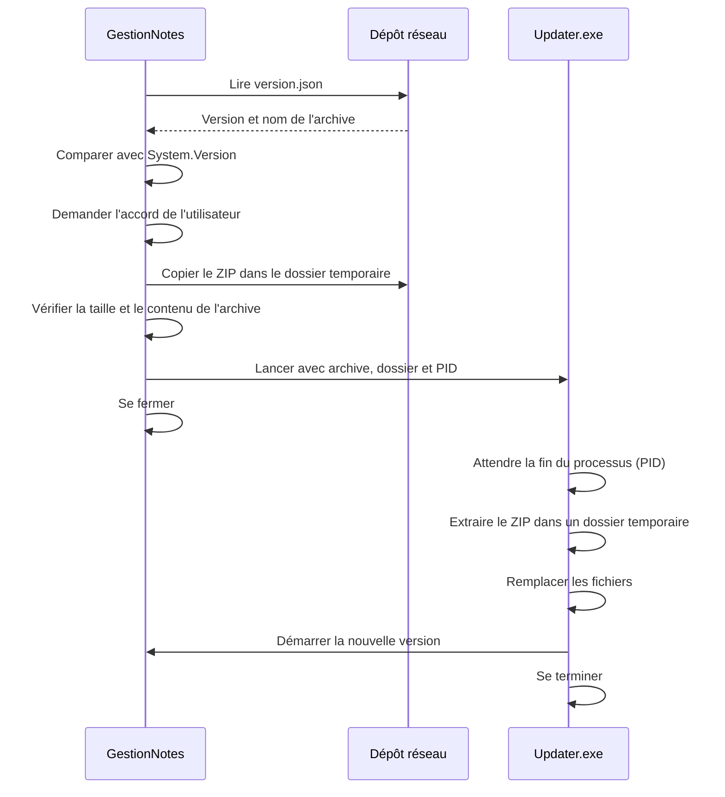

### Vérification de la version

`ServiceMiseAJour.VerifierVersion` lit `version.json`, le désérialise avec `System.Text.Json`, puis compare la version disponible à la version de l'assembly avec `System.Version`. La comparaison porte sur des nombres et non sur du texte : 1.10 est donc bien plus récente que 1.2.

### Copie locale

`ServiceMiseAJour.TelechargerMiseAJour` vérifie que l'archive existe, la copie dans un sous-dossier unique de `%TEMP%\GestionNotes\MisesAJour`, puis compare sa taille à celle du fichier d'origine. Elle ouvre ensuite l'archive pour confirmer qu'elle est lisible et que `GestionNotes.exe` se trouve à sa racine. Si une vérification échoue, GestionNotes reste ouverte.

### Coordination des processus

GestionNotes transmet à `Updater.exe` le chemin de l'archive locale, le dossier d'installation et son identifiant de processus, puis se ferme. `Updater.exe` utilise `Process.GetProcessById` et `WaitForExit` pour ne remplacer aucun fichier tant que GestionNotes tourne.

### Protection de l'installation

Avant le remplacement, `Updater.exe` sauvegarde les fichiers installés dans un dossier temporaire. Si la copie échoue, il restaure cette sauvegarde. Dans tous les cas d'erreur, il affiche un message puis relance la version présente dans le dossier d'installation.

### Pourquoi un programme auxiliaire ?

Windows verrouille l'exécutable et les bibliothèques d'un programme en cours d'exécution. GestionNotes ne peut donc pas remplacer ses propres fichiers de façon fiable. `Updater.exe` s'en charge une fois l'application fermée, puis la redémarre.

### Pourquoi copier l'archive localement ?

Le remplacement ne doit pas dépendre du réseau. Si le partage devenait inaccessible pendant l'opération, l'installation pourrait rester à moitié remplacée. Avec une copie locale vérifiée, toute l'archive est disponible sur le poste avant la fermeture de l'application.

## 6. Gestion des erreurs

| Situation | Comportement attendu | Validation |
|---|---|---|
| Dossier réseau inaccessible | Message, l'application reste utilisable | Réussi (scénario 3) |
| `version.json` absent | Message, l'application reste utilisable | Réussi |
| Manifeste JSON invalide | Message, l'application reste utilisable | Réussi |
| Aucune nouvelle version | L'application démarre sans message | Réussi (scénario 2) |
| Archive ZIP absente | Message, l'application n'est pas fermée | Réussi (scénario 5) |
| Copie de l'archive échouée | Message, l'application n'est pas fermée | Géré dans le code, hors des 5 scénarios |
| Archive impossible à extraire | Message, l'installation reste utilisable | Archive vérifiée avant la fermeture, logique de `Updater.exe` simulée sur macOS |
| Mise à jour refusée | L'application continue avec la version installée | Réussi (scénario 4) |

## 7. Validation

Jeu de données utilisé dans les scénarios : un étudiant avec les notes **80** et **100**. La version 1.0 affiche une moyenne de **60.00** à cause du bogue, et la version 1.1 affiche **90.00**. Comme les données sont conservées, le même étudiant sert de preuve avant et après la mise à jour.

### Scénario 1 — Mise à jour réussie

**Départ :** version 1.0 installée, version 1.1 annoncée par le dépôt.
**Attendu :** après acceptation, l'application se ferme, les fichiers sont remplacés et elle redémarre en version 1.1.
**Résultat :** réussi. L'application a redémarré seule et la moyenne de l'étudiant est passée à 90.00.

Version avant la mise à jour :

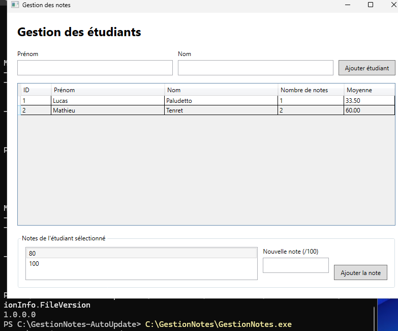

Détection de la nouvelle version :

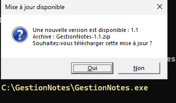

Archive copiée localement, avant le lancement de `Updater.exe` :

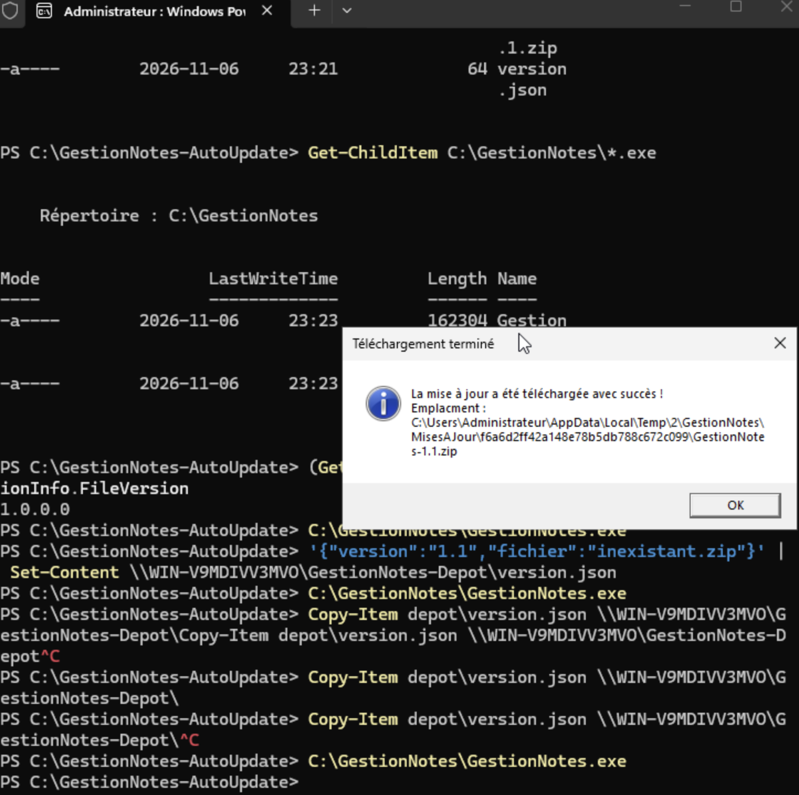

Version après la mise à jour :

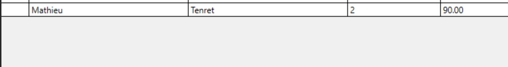

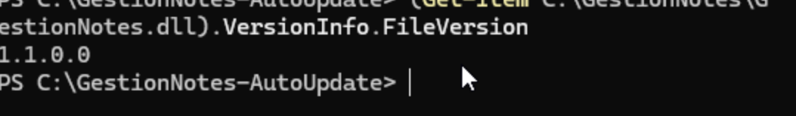

### Scénario 2 — Aucune mise à jour nécessaire

**Départ :** version 1.1 installée, version 1.1 annoncée par le dépôt.
**Attendu :** aucune mise à jour n'est appliquée et l'application fonctionne normalement.
**Résultat :** réussi. L'application a démarré sans proposer de mise à jour.

### Scénario 3 — Partage réseau inaccessible

**Départ :** partage temporairement désactivé sur la VM.
**Attendu :** un message s'affiche et l'application reste utilisable.
**Résultat :** réussi. Le message « Le dépôt réseau est inaccessible ! » s'affiche et l'application continue. Le partage a ensuite été rétabli.

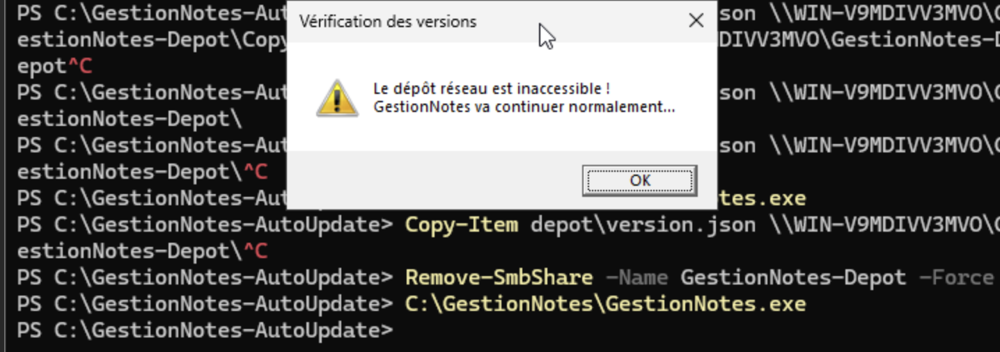

### Scénario 4 — Refus de la mise à jour

**Départ :** une version plus récente est annoncée.
**Attendu :** après le refus, l'application continue avec la version déjà installée.
**Résultat :** réussi. L'application s'est ouverte normalement en version 1.0.

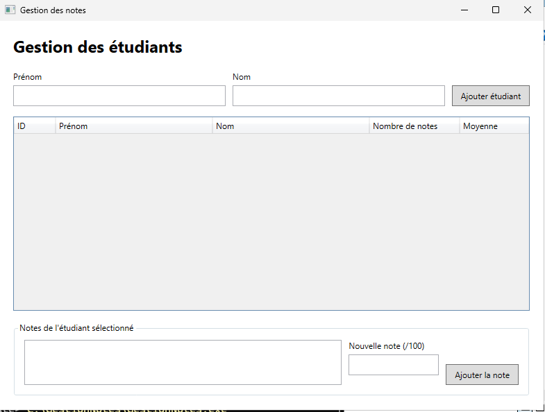

### Scénario 5 — Archive absente

**Départ :** le manifeste désigne temporairement un fichier ZIP inexistant.
**Attendu :** l'erreur est détectée et l'application n'est pas fermée.
**Résultat :** réussi. Le message « L'archive ZIP est introuvable dans le dépôt réseau ! » s'affiche et l'application reste ouverte. Le manifeste a ensuite été rétabli.

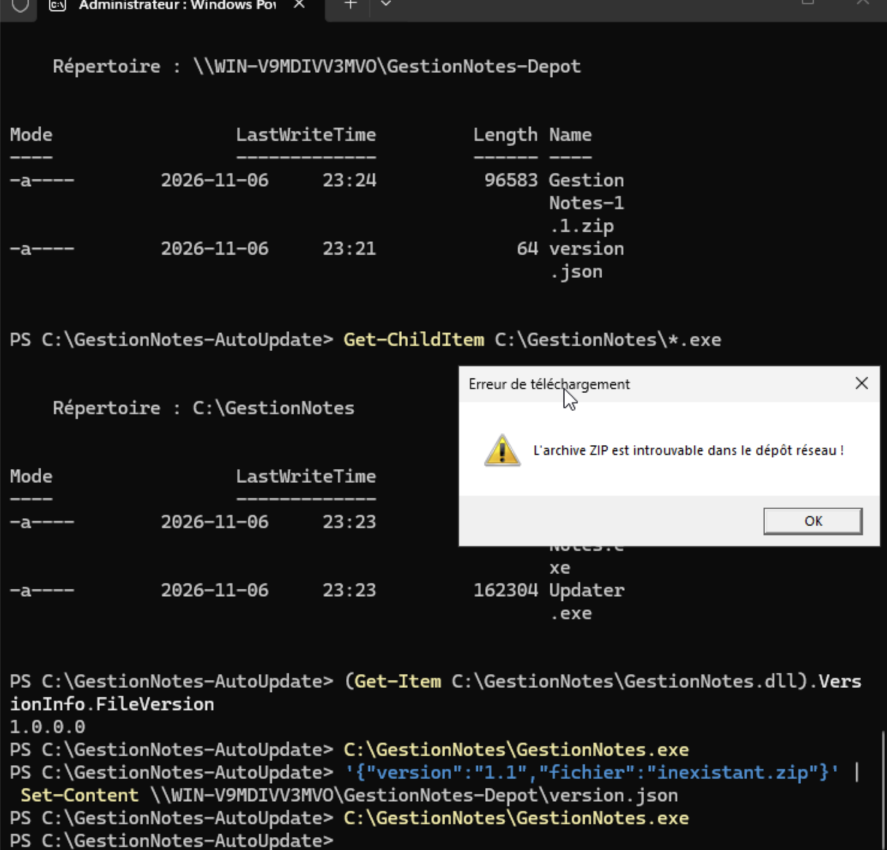

## 8. Problèmes rencontrés et corrections

| Problème | Cause | Correction |
|---|---|---|
| `Updater.exe` recevait 2 arguments au lieu de 3 | Le `\` final du dossier d'installation échappait le guillemet fermant | Passage des arguments avec `ProcessStartInfo.ArgumentList` |
| Une archive invalide n'était détectée qu'après la fermeture de l'application | L'archive n'était ouverte que par `Updater.exe` | Ouverture de l'archive et recherche de `GestionNotes.exe` avant la fermeture |
| Un échec de copie pouvait laisser une installation à moitié remplacée | Aucune sauvegarde ni relance | Sauvegarde, restauration et relance de l'application |
| `Updater.dll` pouvait bloquer le remplacement | Seul `Updater.exe` était exclu de la copie | Exclusion de tous les fichiers `Updater.*` |
| Le ZIP annoncé par le manifeste ne pouvait pas mettre l'application à jour | Il contenait le projet source de la version 1.0, dans des sous-dossiers | Publication d'une vraie archive 1.1, avec les fichiers à sa racine |
| Les versions 1.1 et 2.0 fournies ne contenaient pas le mécanisme | Elles viennent du code d'origine | Version 1.1 reconstruite à partir de notre code (tags `v1.0` et `v1.1`) |

## 9. Conclusion

Le mécanisme fonctionne de bout en bout : GestionNotes détecte une nouvelle version dans le dépôt réseau, copie et vérifie l'archive en local, puis `Updater.exe` remplace les fichiers après la fermeture de l'application et la redémarre. Les cinq scénarios demandés ont réussi, et les données de l'utilisateur sont conservées pendant la mise à jour.

Limite de la validation : l'application a été exécutée sur la VM elle-même, et seul l'accès au partage a été vérifié depuis un autre poste.
